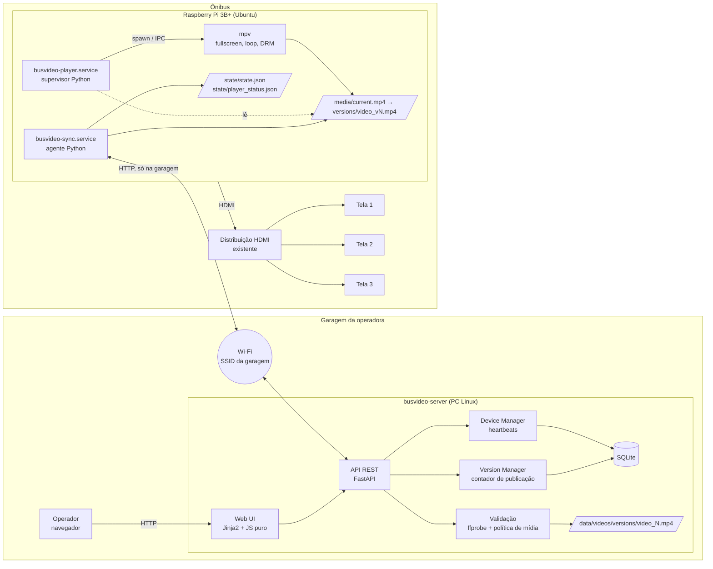

# Arquitetura

Sistema: **Content Distribution System for Embedded Bus Displays**
Produto da Empresa Exemplo. Protótipo v0.1.

## 1. Princípios

| Princípio | Consequência no código |
|---|---|
| O servidor é a fonte oficial do conteúdo | Só o servidor cria versões. O Pi nunca decide conteúdo. |
| O Raspberry Pi é um terminal autônomo | Player e agente são processos separados. O player não conhece o servidor. |
| O Wi-Fi é só o mecanismo de sincronização | `busvideo-sync` faz polling eventual. Sem rede, não faz nada. |
| O armazenamento local é a fonte de reprodução | mpv abre sempre `/opt/busvideo-player/media/current.mp4`. |
| A atualização é eventual, automática e atômica | Download em segundo plano, validação completa, um único `rename()` na troca. |
| O último vídeo válido permanece sempre disponível | Arquivos versionados. O antigo só é apagado depois da troca, e só se exceder `KEEP_VERSIONS`. |

## 2. Componentes



### 2.1 Servidor (`server/busvideo_server`)

| Módulo | Responsabilidade |
|---|---|
| `config.py` | Lê `server.env` + variáveis de ambiente. `MediaPolicy` configurável. |
| `security.py` | PBKDF2-SHA256 para senha, sessão assinada com HMAC. Só stdlib. |
| `db.py` | SQLite em modo WAL. Tabelas `videos`, `publications`, `devices`, `device_events`. |
| `services/storage.py` | Upload em streaming para `incoming/upload_<uuid>.tmp`, SHA-256 em uma passada, ffprobe, política, move para `versions/video_<id>.mp4`. |
| `services/validation.py` | Executa `ffprobe` (somente leitura) e extrai metadados. |
| `services/media_policy.py` | Aplica limites: container, codec, resolução, FPS, level H.264, bitrate, duração, tamanho. |
| `services/versions.py` | Publicação = novo número no contador. `latest()`, `by_version()`, `history()`. |
| `services/devices.py` | Upsert por heartbeat; status derivado; eventos. |
| `api/` | `health`, `auth_routes`, `video`, `devices`. |
| `web/` | Tela única do operador + login. Sem CDN, sem build. |

### 2.2 Terminal embarcado (`client/busvideo_client`)

| Módulo | Responsabilidade |
|---|---|
| `config.py` | Lê `client.env`. Caminhos derivados de `BASE_DIR`. |
| `sync.py` | Ciclo: rede → descoberta → heartbeat → `latest` → espaço → download → validação → troca → limpeza → heartbeat. |
| `net.py` | Presença de rede (UDP connect, sem enviar pacote) e cascata de `SERVER_URLS` via `/api/health`. |
| `http.py` | urllib com timeout, bearer token, `Range` e `If-Range`. |
| `download.py` | `download/video.tmp` + `video.part.json`. Retomada, limite de taxa, fsync. |
| `validate.py` | Tamanho, SHA-256, formato (ffprobe, mpv ou desligado). |
| `media.py` | Versões em `versions/`, symlink `current.mp4`, espaço com margem, rollback, limpeza. |
| `supervisor.py` | Mantém o player vivo, detecta mudança do symlink, troca no fim do loop, rollback se o novo arquivo não carregar, detecta travamento. |
| `player/base.py` | Interface `Player`. `player/mpv.py` (produção, IPC JSON) e `player/fake.py` (testes e demo). |
| `transport/base.py` | Interface de canal de manutenção (Bluetooth na fase 2) + `StatusProvider`. |
| `sdnotify.py` | `READY=1` e `WATCHDOG=1` para o systemd, sem dependências. |

## 3. Fluxo de atualização

```mermaid
sequenceDiagram
    autonumber
    participant P as busvideo-player (supervisor + mpv)
    participant S as busvideo-sync
    participant A as busvideo-server

    Note over P: reproduz current.mp4 → video_v11.mp4 em loop
    loop a cada SYNC_INTERVAL (60 s), backoff até 5 min fora da garagem
        S->>S: há rota de rede para algum SERVER_URL?
        S->>A: GET /api/health (timeout 3 s) na cascata de URLs
        S->>A: POST /api/devices/heartbeat
        S->>A: GET /api/video/latest
        A-->>S: {version: 12, size, sha256, download_url}
        alt version <= local
            S-->>S: "up-to-date"
        else sha256 igual ao local (republicação)
            S->>S: hard link + symlink para v12, sem download
        else nova versão
            S->>S: ensure_space(size + DISK_MARGIN_MB); remove rollback se preciso
            S->>A: GET /api/video/download/12 (Range: bytes=<parcial>-, If-Range: "<sha256>")
            A-->>S: 206/200 em chunks → download/video.tmp
            Note over S: Wi-Fi caiu? tmp e part.json ficam; retoma no próximo ciclo
            S->>S: size == expected? sha256 == expected? ffprobe: h264?
            alt inválido
                S->>S: apaga tmp, registra falha da versão, ERROR, heartbeat status=error
            else válido
                S->>S: rename tmp → versions/video_v12.mp4 (+fsync)
                S->>S: symlink current.mp4.new → rename → current.mp4
                S->>S: state.json (atômico): current_version=12
                S->>A: heartbeat {current_version: 12, status: ok}
                S->>S: cleanup: mantém KEEP_VERSIONS
            end
        end
    end
    P->>P: a cada 1 s: current.mp4 aponta para outro inode?
    P->>P: espera o fim do loop (time-pos volta a ~0) ou SWITCH_MODE=immediate
    P->>P: mpv loadfile video_v12.mp4 replace
    alt mpv não confirma reprodução
        P->>P: rollback: symlink → v11, recarrega v11
    end
```

## 4. Troca atômica com symlink

`current.mp4` é um **symlink** para `versions/video_vN.mp4`. A troca é:

1. `fsync` do arquivo novo e `rename(video.tmp, versions/video_v12.mp4)`.
2. Cria `current.mp4.new` apontando para `versions/video_v12.mp4`.
3. `rename(current.mp4.new, current.mp4)` e `fsync` do diretório.

Por que não renomear o tmp diretamente sobre `current.mp4`: seria preciso antes mover o atual para `previous.mp4`, e entre os dois renames existe uma janela em que `current.mp4` não existe. Se a energia cair nessa janela, o próximo boot não tem vídeo. Com o symlink, `current.mp4` aponta ou para o antigo ou para o novo em qualquer instante, e o arquivo antigo continua existindo com nome próprio para rollback. O mpv já aberto mantém o inode antigo até recarregar, então nada corta a reprodução.

O supervisor compara `os.path.realpath(current.mp4)` com o caminho em reprodução. Se diferem, agenda a troca. Isso funciona mesmo que o `busvideo-sync` tenha morrido logo após o rename.

## 5. Versionamento

- `version` é um **contador de publicação** (`publications.version`, AUTOINCREMENT). Cada clique em PUBLICAR gera um número novo, mesmo para um vídeo já publicado antes.
- O cliente aplica `version > current_version`. Se o `sha256` anunciado é igual ao local, atualiza só o número (hard link + symlink) sem baixar.
- Republicar um vídeo antigo é o rollback do operador: versão 13 apontando para o conteúdo da versão 10. O cliente não precisa de lógica especial.
- O download é sempre por número de versão (`/api/video/download/{version}`), com `ETag` igual ao SHA-256. Uma publicação no meio de um download não troca o conteúdo por baixo do cliente; na retomada, `If-Range` diferente faz o servidor devolver 200 e o cliente recomeça do zero.
- Falhas por versão são contadas em `state.json` (`failures`). Após `MAX_FAILURES_PER_VERSION` (3), o cliente espera `FAILURE_COOLDOWN_S` (30 min) antes de tentar de novo.

## 6. Escolha do player

| Critério | mpv (escolhido) | GStreamer (fallback) | VLC (descartado) |
|---|---|---|---|
| Decodificação H.264 por hardware no Ubuntu/Pi 3B+ | `--hwdec=v4l2m2m-copy` via FFmpeg | `v4l2h264dec` zero-copy | Irregular |
| Saída sem X11 | `--vo=gpu --gpu-context=drm` | `kmssink` | Precisa de X ou framebuffer |
| Loop | `--loop-file=inf` nativo | Programa próprio | `--loop` |
| Controle por processo | Socket IPC JSON (`loadfile`, `time-pos`, `path`, `idle-active`) | Mensagens do bus | RC/telnet |
| RAM 1080p | 60 a 90 MB | 40 a 60 MB | 120 a 200 MB |

No Ubuntu para Pi, a aceleração não usa OMX/MMAL (exclusivos do Raspberry Pi OS legado). Usa V4L2 Memory-to-Memory (`/dev/video10`, módulo `bcm2835-codec`) exposto ao FFmpeg como `h264_v4l2m2m`. O Cortex-A53 a 1,4 GHz não decodifica 1080p30 por software. Por isso o benchmark no hardware (`scripts/benchmark-player.sh`) é obrigatório antes de instalar em campo.

Linha de comando gerada por `player/mpv.py`:

```
mpv --no-config --fs --loop-file=inf --no-osc --no-osd-bar --no-terminal \
    --no-input-default-bindings --input-vo-keyboard=no --really-quiet \
    --keep-open=no --idle=yes --force-window=yes \
    --input-ipc-server=/run/busvideo-player/mpv.sock --cache=yes --demuxer-max-bytes=64MiB \
    --vo=gpu --gpu-context=drm --hwdec=v4l2m2m-copy --audio=no \
    /opt/busvideo-player/media/current.mp4
```

Se o benchmark reprovar o mpv, a interface `Player` permite adicionar `player/gstreamer.py` sem tocar no supervisor.

## 7. Três telas

O Pi 3B+ tem uma saída HDMI. Assunção inicial obrigatória:

```
Raspberry Pi → HDMI → sistema de distribuição existente → Tela 1 / Tela 2 / Tela 3
```

Um único player, mesma imagem nas três telas. Nada a implementar além de um sinal HDMI estável. Distribuidores/splitters costumam ter EDID instável; recomendação em `config.txt`: `hdmi_force_hotplug=1` e modo fixo. Se a inspeção física mostrar um Pi por tela, cada um vira um terminal (`BUS-001-A`, `-B`, `-C`); o modelo de dados já suporta.

## 8. Descoberta do servidor

Cascata configurável em `SERVER_URLS`, testada com `GET /api/health` (timeout `HEALTH_TIMEOUT`):

| Ordem | Método | Exemplo |
|---|---|---|
| 1 | IP fixo (reserva DHCP) | `https://192.168.100.10` |
| 2 | Hostname DNS local | `https://busvideo-server` |
| 3 | mDNS (opcional, exige avahi) | `https://busvideo-server.local` |

O agente memoriza o último endereço que respondeu e o tenta primeiro no ciclo seguinte. Antes de qualquer HTTP, `net.has_network()` verifica se existe rota para algum dos hosts (UDP connect, sem enviar pacote), evitando timeouts fora da garagem. Não existe protocolo de broadcast próprio.

## 9. Recuperação de falhas

| Cenário | Comportamento | Onde |
|---|---|---|
| Servidor desligado | `health` falha em 3 s. Backoff 60 s → 5 min. Uma linha de log a cada 10 min. | `sync._quiet()` |
| Sem Wi-Fi | Não tenta HTTP. Reconexão é do SO. | `net.has_network()` |
| Download interrompido | `video.tmp` e `video.part.json` preservados. Retoma com `Range`. | `download.py` |
| Servidor ignora Range | Recomeça do zero automaticamente. | `download.py` |
| Hash/tamanho/formato inválido | tmp apagado, falha contada, `status=error`, `last_error` no heartbeat. | `sync._update()` |
| Publicação no meio do download | Download por número de versão + `If-Range`. | `api/video.py` |
| Pi reiniciado | `state.json` reconciliado com o symlink real. Tmp órfão apagado. | `sync._reconcile_state()` |
| Falta de espaço | Remove cópias de rollback (nunca a atual). Se ainda faltar: `Insufficient disk space`. | `media.ensure_space()` |
| Player morre | Supervisor reinicia em ≤ 2 s com backoff. Após 5 falhas seguidas, rollback para a versão anterior. | `supervisor.ensure_playing()` |
| Player trava | `time-pos` parado 15 s → reinicia. | `supervisor.check_stall()` |
| Novo vídeo não carrega no mpv | Rollback do symlink e recarga do anterior. | `supervisor.apply_pending()` |
| Processo Python travado | `WatchdogSec` do systemd + `Restart=always`. | units |
| Token errado | `401` → `last_error` "Server rejected device token". | `sync.run_once()` |
| Relógio errado (sem RTC) | Retry usa `time.monotonic()`. Opcional `SET_TIME_FROM_SERVER`. | `sync._maybe_set_time()` |

Em todos os casos o symlink `current.mp4` só muda depois da validação completa.

## 10. Armazenamento

```
/opt/busvideo-player/
├── app/busvideo_client/
├── config/client.env
├── media/
│   ├── current.mp4 -> versions/video_v12.mp4
│   ├── versions/video_v12.mp4
│   ├── versions/video_v11.mp4           # rollback (KEEP_VERSIONS=2)
│   └── download/video.tmp, video.part.json
├── state/state.json, player_status.json
└── logs/sync.log, player.log            # 1 MB x 3 cada
/run/busvideo-player/mpv.sock                 # tmpfs
```

Pico de uso: 3 × tamanho do vídeo (atual + anterior + download). Com `KEEP_VERSIONS=1`: 2 ×. Escritas no SD são mínimas: `state.json` só quando muda, `player_status.json` só quando muda, chunks de 1 MiB, logs limitados.

Servidor:

```
/opt/busvideo-server/
├── app/, venv/
├── config/server.env
├── data/busvideo.db
├── data/videos/incoming/upload_<uuid>.tmp
├── data/videos/versions/video_<id>.mp4
└── logs/server.log                      # 10 MB x 5
```

## 11. Segurança

| Área | Medida |
|---|---|
| Transporte | HTTPS obrigatório na porta 443 com certificado emitido pela **CA da garagem** (`busvideo_server.tls`). Ônibus fixam a CA (`CA_CERT`); operadores instalam o `ca.crt`. Porta 80 só redireciona e entrega o `ca.crt`. HSTS. |
| Interface do painel | Login obrigatório, duas contas (`operador` e `admin`; só `admin` redefine senhas). Senhas só como hash PBKDF2 na tabela `users` (semeadas do `server.env`). Cookie `busvideo_session` assinado, `HttpOnly`, `SameSite=Lax`, `Secure`. 5 tentativas/min por IP. Checagem de origem (CSRF) nas requisições com cookie. CSP sem inline, `X-Frame-Options: DENY`, `nosniff`. |
| Dispositivos | `Authorization: Bearer DEVICE_TOKEN`. Sem token configurado, tudo é negado. |
| Upload | Limite aplicado em streaming (413). Extensão, ffprobe, política. Nome de arquivo gerado pelo sistema; o nome original é só exibido, sanitizado. |
| Path traversal | Nenhuma rota recebe caminho. Download resolve por número de versão no banco. |
| Execução de arquivo | Impossível por desenho: só ffprobe e mpv leem o arquivo. Permissões `0640` no servidor, `0644` no Pi. |
| Usuários Linux | `busvideo-server` e `busvideo`, sem shell. Units com `NoNewPrivileges`, `ProtectSystem=strict`, `ReadWritePaths` restritos. |
| Rede | Servidor na LAN. `ufw` libera só a porta do serviço. Pi não abre porta. |
| Internet | Nenhuma dependência em runtime. |
| Logs | Nunca registram token ou senha. |

## 12. Limites de recursos (Pi 3B+, 1 GB)

| Serviço | Limite | Motivo |
|---|---|---|
| `busvideo-sync` | `MemoryMax=200M`, `Nice=10`, I/O best-effort baixa prioridade | Não competir com a leitura do vídeo no SD |
| `busvideo-player` | `MemoryMax=400M`, `OOMScoreAdjust=-500` | O player é o processo a preservar |

Consumo esperado: agente ≈ 15 MB, supervisor ≈ 12 MB, mpv ≈ 60 a 90 MB.

## 13. Evolução prevista

| Funcionalidade | Como a arquitetura já prepara |
|---|---|
| Bluetooth (diagnóstico, identificação, configuração) | `transport/base.py`: `MaintenanceTransport` + `StatusProvider` que lê `state.json` e `player_status.json`. Um serviço BLE GATT ou RFCOMM implementa a interface sem tocar no agente. |
| Conteúdo por ônibus / grupos | `publications` ganha campo `target`; `latest` filtra por `device_id`. |
| Playlists e agendamento | `latest` devolve uma lista com `valid_from/valid_until`; o supervisor já abstrai o player. |
| Histórico e dashboard | `device_events` e `publications` já são gravados. |
| Transcodificação automática | Passo extra em `storage.receive_upload()` com ffmpeg. |
| Atualização do próprio agente (OTA) | Mesmo mecanismo de download validado, com pacote em vez de vídeo. |
| HTTPS interno / token por dispositivo | Camada `auth.py` isolada. |
